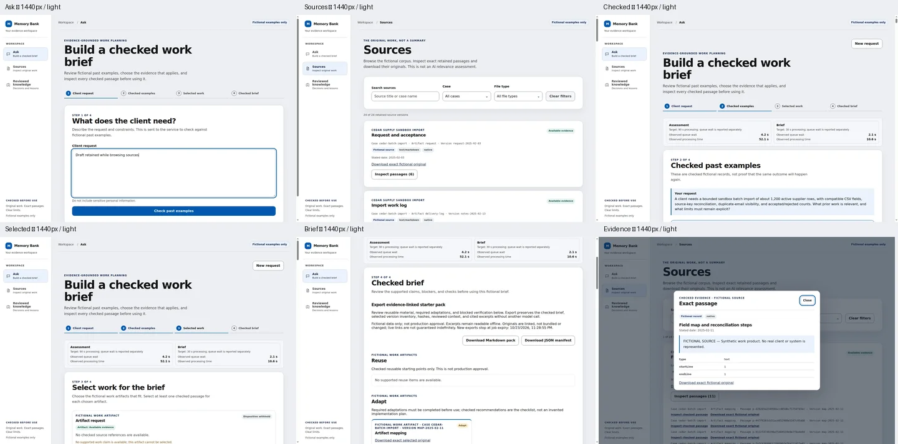

# Memory Bank

**Turn past project evidence into better reuse decisions.**

Memory Bank helps delivery leads compare a new client request with reviewed examples from fictional projects. Inspect the evidence, choose the work that applies, and create a checked reuse brief. Similarity is not proof; a person reviews every recommendation.

## Tech stack
     

- **Web:** React + TypeScript with Vite; Hono API on Cloudflare Workers.
- **Data:** PostgreSQL (Neon in production), R2 for source files, and Cloudflare Queues/Workflows for durable jobs.
- **AI and corpus:** Configurable LLM endpoints (OpenRouter by default); separate semantic search with Workers AI + Vectorize; Python tools for offline corpus ingestion.



## How it works

1. **Describe the request** and the constraints that matter.
2. **Review checked examples** with linked claims and exact source passages.
3. **Select the relevant work** by artifact, version, and passage.
4. **Review and export a brief** with evidence-backed next steps.

## The three outcomes

- **Reuse** — evidence supports using the work as-is.
- **Adapt** — use it as a starting point, with the listed changes and checks.
- **Verify** — resolve a decision-critical question before using it.

## How it differs from common RAG

A common top-k RAG chat retrieves a few relevant text chunks, then drafts an answer. Memory Bank’s Ask workflow is built around a reviewed reuse decision:

| | Common top-k RAG | Memory Bank Ask |
| --- | --- | --- |
| **Context** | A small set of retrieved chunks | The pinned case inventory and its available source passages |
| **Checks** | Grounding checks depend on the implementation | The server validates exact source references; a separate reviewer checks claim support |
| **Decision** | The model returns an answer | The lead selects exact artifacts, versions, and passages before the brief is drafted and reviewed |

Memory Bank also offers semantic search in **Sources** for browsing passages. That search does not select evidence for Ask.

Unknowns stay unknown. Every example in this demo is fictional; checked recommendations are not production approval.

## Application overview

[](docs/images/memory-bank-overview.svg)

## Service blueprint

[](docs/images/memory-bank-service-blueprint.svg)

[Local setup and technical notes](#developer-and-operator-notes)

<details id="developer-and-operator-notes">
<summary>Developer and operator notes</summary>

The sections below retain detailed local setup, qualification, and operations guidance.

## Local setup

1. Install Node.js 22.18+ (verified with 24.19), Python 3.12+, and Docker Compose. Run `npm ci`.
2. Create a Python environment and install the offline parsers:

   ```sh
   python3 -m venv .venv
   . .venv/bin/activate
   pip install -r ingestion/requirements.txt
   ```

3. Copy `.dev.vars.example` to `.dev.vars`. Set `OPERATOR_TOKEN` to `openssl rand -hex 32`. Configure the model endpoint below and set its API key only when you are ready to make approved paid model calls. Never commit `.dev.vars`.
4. Start local PostgreSQL: `docker compose up -d --wait postgres`. First initialization applies the SQL files in `migrations/` in filename order. The database is loopback-only on port 5433; the project-scoped `postgres_data` Docker volume preserves accounting and admission state across restarts and container recreation. Keep the same Compose project name/directory when returning to a campaign; another worktree/project gets a different volume, not the original ledger.
5. Build the curator manifest and audit: `npm run ingest`. Publish only to cf local R2: `npm run publish:corpus`.
6. Run `npm run dev`, then open `http://127.0.0.1:8787`. This builds with `cf` and serves the bundled Worker using Vite preview in development mode. Restart after edits; there is no hot reload. Bundling preserves startup-time AJV schema compilation, which the Vite development module runner rejects as dynamic code generation.

Fresh ledgers start with admission disabled as a bootstrap safeguard, not an ongoing requirement to keep paid work disabled. Before enabling it, verify the selected provider's initial remaining credit and model pricing in its dashboard or read-only API (OpenRouter: `GET /api/v1/credits` and `GET /api/v1/models`); round remaining credit down to integer microUSD. `/api/operator/budget` records that campaign balance (1 USD = 1,000,000 microUSD). Metadata checks do not qualify the model route or full workflow. The $5 maximum caps admission, not provider invoices. The $0.30-per-call and $0.60-per-phase values are holds, not hard charge limits. Reconcile every terminal phase—including successful ones—against actual provider usage before further admission; the hold remains until reconciled, and an overage blocks later admissions but cannot prevent the provider charge. Do not reset the balance to the post-spend dashboard remainder because the ledger also subtracts reconciled spend. Disable admission if external activity changes the balance. This endpoint cannot query, add, or top up credit.

The app has no fake AI fallback. Without a valid key and enabled ledger, paid jobs fail closed. Local queues, Workflows, and R2 use the cf local platform simulation, persisted under the project's `.cloudflare/state`; the corpus publisher explicitly selects the same store as Vite. Local setup never provisions or deploys remote infrastructure. Production uses the separate resources below; no Wrangler dependency or configuration is used.

## Model endpoints

OpenRouter remains the default: existing `OPENROUTER_API_KEY` configuration continues to use `openai/gpt-6-luna` on the pinned OpenAI-only route. Choose one provider per deployment; there is no automatic retry or provider fallback.

For an OpenAI Chat Completions-compatible service, set these in `.dev.vars`:

```dotenv
MODEL_PROVIDER=openai
MODEL_BASE_URL=https://your-openai-gateway.example/v1
MODEL_NAME=your-model-id
OPENAI_API_KEY=your-api-key
```

For an Anthropic Messages-compatible service:

```dotenv
MODEL_PROVIDER=anthropic
MODEL_BASE_URL=https://your-anthropic-gateway.example/v1
MODEL_NAME=your-model-id
ANTHROPIC_API_KEY=your-api-key
```

For [OpenCode Go](https://opencode.ai/docs/go/), use a separate Go credential and explicitly select the model's protocol:

```dotenv
MODEL_PROVIDER=opencode-go
MODEL_API=responses
MODEL_NAME=gpt-6-luna
OPENCODE_API_KEY=your-go-api-key
```

Leave `MODEL_BASE_URL` unset to use Go's endpoint for the selected protocol. Match `MODEL_API` to the current [Go endpoint table](https://opencode.ai/docs/go/#endpoints), not just the model's vendor:

| `MODEL_API` | Example model ID | Default versioned base |
| --- | --- | --- |
| `chat-completions` | `kimi-k3`, `glm-5.3-flash` | `https://opencode.ai/inference/go/openai/v1` |
| `messages` | `minimax-m3`, `claude-haiku-5-5` | `https://opencode.ai/inference/go/anthropic/v1` |
| `responses` | `gpt-6-luna` | `https://opencode.ai/inference/go/openai/v1` |

Go requests identify this application as `User-Agent: memory-bank/0.1.0`. `x-opencode-session` is the persisted job UUID, shared across assessment/brief drafts and reviews, including process restarts; separate jobs have separate sessions. No visitor capability or request text is used as a session ID. Go requires `MODEL_NAME` and `MODEL_API`; other providers retain their existing protocols and credentials. Native Google/Gemini endpoints are not implemented.

**Qualification and usage policy:** Go is designed for coding-agent traffic; obtain provider approval for this evidence-analysis workload before using it. Its [model-specific privacy policies](https://opencode.ai/docs/go/#privacy) differ. Protocol support is not proof that a particular Go model accepts our complete stage schemas or forced tool choice. No Go key was available for live inference during this change: Kimi/GLM strict schemas and Messages forced-tool behavior remain unqualified against the real service. Verify all four stages with the selected model before enabling campaign admission; do not weaken validation or retry/fall back after a rejection. Go subscription allowance is not a cash credit balance, and missing USD cost must still be reconciled rather than treated as free.

`MODEL_BASE_URL` is a versioned API base, not a full completion URL: the app appends `/chat/completions`, `/messages`, or `/responses`, preserving gateway path prefixes. Compatible modes default to `https://api.openai.com/v1` or `https://api.anthropic.com/v1`; Go defaults are above. HTTPS is required except for loopback HTTP (for example, `http://127.0.0.1:11434/v1`); URL credentials, query strings, fragments, and redirects are rejected. `MODEL_NAME` is required outside the default OpenRouter mode. Only the selected provider's key is used.

Chat Completions endpoints must support strict JSON Schema `response_format`; Messages endpoints must support forced tool choice and return a single `submit_result` tool input. Responses requests use strict `text.format`, `max_output_tokens: 16384`, `store: false`, and accept only a completed assistant JSON result, rejecting incomplete/error/refused/tool-call outputs. Every route must support the stage schemas and 16,384 output tokens. All results still pass the same local schema, reference and independent-review checks; incomplete/refused/invalid results fail closed. Token usage is retained; absent provider-reported USD cost stays unknown and must be reconciled from provider billing, never assumed free.

Restart development after configuration changes. Production uses equivalent Worker bindings (these values can be included with the selected credential in `.dev.vars.production` for the existing secrets-file deploy). Drain active workflows and reconcile outstanding charges before switching provider/model; do not reuse a different provider's credit as an unchanged campaign balance. The intake reads `GET /api/model-info` to disclose the actual provider/model and endpoint origin without exposing credentials or gateway paths. Custom endpoint operators must supply upstream processor/privacy information. Endpoint compatibility does not qualify a new model's quality, pricing, context fit, or latency.

Verification: `npm test` passes 46 TypeScript tests and one Python test, including Go's three protocols over real loopback HTTP, foreign-claim/truncation rejection, Responses refusal/error/ambiguity handling, session validation and selected-credential isolation. A separate no-paid-call runtime smoke sent all four stages through each of the three protocols (12 loopback requests), validated outputs against the transmitted full stage JSON schemas, and checked the public model-info projection. Earlier Chromium checks covered the default OpenRouter, OpenAI, Anthropic, custom-endpoint and unavailable-configuration states; unavailable configuration blocked submission. These checks are protocol/UI proof, not real-provider inference or model qualification.

The actual development Worker and Chromium intake disclosed `opencode-go`, `gpt-6-luna`, `https://opencode.ai`, and Go's model-specific policy link from `.dev.vars` bindings. At the observed 400px viewport the page had no horizontal overflow. Filling the request enabled submission, but no job was submitted and no external inference request was made.

`npm run typecheck` and the production build passed. The isolated `node --experimental-transform-types src/server/ledger.smoke.ts` verified Go's identifying headers and persisted the configured model and endpoint host on an uncertain dispatch, exposed them in operator status, preserved accounting/replay guards across restart, container recreation and backup restore, and added no provider network requests. Development bindings are explicitly declared so `.dev.vars` settings actually reach the local Worker; production continues to use the selected secrets-file bindings. No live campaign state, credentials, admission setting or deployment was changed.

## Paid admission authorization

The owner authorized paid assessment and brief admission on 2026-10-17 for local and production operation within the existing $5 campaign ceiling and verified existing credit. Do not disable admission merely because qualification remains incomplete, a UI-only check is being run, or a work session ends. Budget, credential, concurrency, evidence, and reconciliation gates remain enforced; this authorization does not purchase credit, reset a ledger, qualify model output, or authorize public release.

To enable admission, use the target environment's operator token to inspect `GET /api/operator/status`, verify the required database migrations and model credential, and resolve outstanding billing uncertainty against provider records. Send `PUT /api/operator/budget` with `admissionEnabled: true` and `availableCreditMicroUsd` set to the verified initial campaign balance (at most 5,000,000). For an existing campaign, preserve its recorded balance rather than substituting the post-spend provider remainder; do not reset spend or holds. Read status again and verify `campaign.admissionEnabled` is `true` and `campaign.headroomMicroUsd` can cover the next phase. Reconcile each terminal phase before the next one.

This README records permission, not observed live state: editing or deploying it does not toggle admission. The authenticated status endpoint is authoritative. Temporary pauses for database migration/recovery or an accounting discrepancy remain safety requirements; after resolving them, restore authorized admission rather than leaving it disabled by default.

## Operator-only local operations

Use `Authorization: Bearer $OPERATOR_TOKEN` with `/api/operator/status` to inspect active work, provider usage, reservations, and reconciliation history. `PUT /api/operator/budget` accepts `availableCreditMicroUsd` and `admissionEnabled`; it only sets the owner's verified existing balance and does not create credit.

Failed model attempts also expose `http_status`, `failure_phase`, and `failure_cause` to the operator. Phases distinguish request preparation, fetch, response headers/body, response validation, and output validation. Transport causes are limited to `deadline_exceeded`, `timeout`, `aborted`, and `transport_error`: only the call's own observed expired deadline yields `deadline_exceeded`; an upstream `TimeoutError` alone does not. Diagnostics retain no raw provider body, arbitrary error message, credential, request text, or stack. Generation IDs are bounded `gen-`, `chatcmpl-`, or `msg_` identifiers, preserved from headers or a decoded envelope even when validation fails. These fields do not change holds, billing uncertainty, deadlines, or replay policy and cannot diagnose older failures retrospectively.

Verify operator authentication and concurrent database access with `node --env-file=.dev.vars --experimental-strip-types src/server/db.smoke.ts` while the local Worker is running. This read-only check submits no model jobs. Each database operation gets its own pool, and each checked-out connection is retired on release; neither sockets nor pending pool connections may cross Worker request contexts.

`POST /api/operator/reconciliations` accepts `reservationId`, `actualMicroUsd`, and a non-empty audit `note`. If a model attempt remains `dispatching`, wait at least two minutes, verify in provider records that it is no longer active, and include `confirmAbandonedDispatch: true`. Never reconcile an uncertain charge by assuming it was free. Reconciliation blocks replay and does not cancel an in-flight provider request.

### Local ledger durability and recovery

The data volume is not a backup. `docker compose down` retains it; **do not use `down --volumes`, `docker volume rm`, or volume pruning on a campaign ledger**. Restarting does not reset budgets, clear holds, or disable previously enabled admission. Existing volumes do not rerun initialization SQL; apply later migrations explicitly before Worker startup.

This Worker requires `migrations/0003_model_failure_diagnostics.sql` on existing databases. With application processing stopped and a verified private backup saved, apply it once after migration 0002:

```sh
docker compose exec -T postgres psql -U memory_bank -d memory_bank \
  -v ON_ERROR_STOP=1 --single-transaction < migrations/0003_model_failure_diagnostics.sql
```

New columns are nullable and constrained to safe values; historical rows remain unknown rather than being backfilled with a guessed failure cause. Fresh databases apply all migrations during initialization.

Cold initialization flushes real disk storage and can take minutes on this WSL host. The health check uses TCP so the temporary socket-only initialization server cannot report readiness before migrations finish. A ten-minute startup grace and PostgreSQL's [`PGCTLTIMEOUT=300`](https://www.postgresql.org/docs/17/app-pg-ctl.html) allow initialization/checkpointing to finish without disabling disk synchronization. These are local database startup controls, not changes to paid model deadlines or retry policy.

**Before replacing a running tmpfs installation:** stop/drain the app's Worker, queue, and Workflow processing and take the backup below before any database restart/recreation. Restore it into the durable setup before resuming. A previously lost tmpfs ledger cannot be recovered by adding a volume; do not reconstruct historical reservations or treat the approved lost-ledger exception as a reconciliation. This change does not initialize or authorize a replacement paid campaign.

With application processing stopped, save a private PostgreSQL custom archive outside Git and `/tmp`:

```sh
umask 077
backup_dir="$HOME/.local/state/memory-bank/backups"
mkdir -p "$backup_dir"
partial=$(mktemp "$backup_dir/ledger-XXXXXXXX.dump.partial")
backup="${partial%.partial}"
docker compose exec -T postgres pg_dump -U memory_bank -d memory_bank --format=custom > "$partial" &&
  mv "$partial" "$backup"
```

Only a successful dump is renamed to `.dump`. Retain the completed archive on durable storage; a second protected copy on a separate device/storage service is needed to survive host/disk loss. Archives contain private job and accounting data: never commit or publish them, and manage their retention separately from the app's seven-day expiry.

Restore a verified archive into a **new, empty database**, not over an existing ledger. Keep all app processing stopped:

```sh
# Set backup to the completed archive's absolute path if using a new shell.
docker compose exec -T postgres createdb -U memory_bank -T template0 memory_bank_restore
docker compose exec -T postgres pg_restore -U memory_bank -d memory_bank_restore \
  --exit-on-error --single-transaction < "$backup"
docker compose exec -T postgres psql -U memory_bank -d memory_bank_restore -v ON_ERROR_STOP=1 \
  -c 'UPDATE campaign_budget SET admission_enabled = false, updated_at = now() WHERE singleton AND admission_enabled;'
```

After every command succeeds, point development `LOCAL_DATABASE_URL` at `memory_bank_restore` and inspect `/api/operator/status` with the operator token before allowing app processing to resume. Verify the budget, holds, active reservation, model attempts, and reconciliation audit against the saved evidence. Keep paid admission closed until recovery and current credit are verified, then restore it under [Paid admission authorization](#paid-admission-authorization). Do not release an uncertain hold or replay a dispatch to discover its cost. Preserve the original database/archive while investigating any mismatch. A PostgreSQL archive does **not** back up R2 originals or Queue/Workflow checkpoints; those runtime resources need their own recovery checks before resuming work.

Run `node --experimental-transform-types src/server/ledger.smoke.ts` for an isolated, no-paid-call recovery check (Docker Compose 2.24.4+). It creates a random Compose project with a loopback ephemeral port, seeds only synthetic accounting, and drives actual paid-stage failure persistence with two intercepted synthetic responses: an interrupted body and token-limited output with reported usage (no provider network access). It checks operator diagnostics, retained holds, exact rows and replay rejection after restart/container recreation, and private archive restoration outside `/tmp` into a fresh database. It removes only its own synthetic containers/volumes/archive; it never reads `.dev.vars` or touches the campaign database. The [diagnostics verification record](docs/qualification-2026-10-15.md#dispatch-diagnostics-and-visitor-disclosure--2026-10-16) distinguishes this local proof from paid qualification.

Observed local verification (2026-10-16): the smoke failed against tmpfs after restart with cleared budgets/holds, an empty attempt/reservation/audit ledger, and a lost active lock. With the named volume and durable-startup settings, all seven tables survived restart and container recreation unchanged; a custom archive restored the same rows into a fresh database. Uncertain and reconciled attempts rejected replay before provider access in every verification phase; provider requests were zero and admission stayed disabled. This verifies synthetic local ledger recovery, not restoration of the lost historical reservation or qualification of a paid workflow.

## Application boundaries

- The runtime reads the published eight-case manifest and exact originals from R2; it verifies SHA-256 before using a source or serving a download.
- `ingestion/` is offline curator tooling. It supports native text/CSV and format-aware Office/PDF/image paths; scans and visual observations require a hash-bound human-audited sidecar. Missing or incomplete extraction is excluded, never guessed.
- `evaluation/keys.json` is offline-only and is not copied into `.cloudflare/output/`, R2, prompts, or application routes. Do not use evaluation keys for prompt tuning.
- Anonymous job capabilities protect status/results. Application request/results expire after seven days; minimal accounting/idempotency records remain for operator reconciliation. Workflow checkpoint retention is configured for seven days; provider/platform/backup retention is separate and is not promised to be zero.
- Before submission, the intake identifies the configured model provider, model and endpoint origin, deployed Cloudflare/Neon storage/processing, and local-development equivalents. Official endpoints link their provider policies; custom endpoints require operator-supplied upstream/privacy information. It distinguishes seven-day application expiry from separate upstream/platform/backup retention, retained billing/replay records, and downloaded packs. The active job's exact expiry is visible during assessment, selection, and brief review, not only export. Terminal panels show the API's safe failure explanation without operator-only diagnostics.
- Queue/Workflow duplicates use stable IDs. Paid model calls have no automatic retries or fallback; uncertain dispatch requires operator reconciliation.
- Human-reviewed decision and lesson cards live in the versioned curator corpus, not expiring jobs. Browse `/?knowledge`, address a record with `/?knowledge=<recordId>`, or inspect it in case details. Cards link exact supporting passages/originals and mark superseded advice as history. Applying a lesson still requires the existing checked, request-specific recommendation pipeline; no new paid stage is added. See [curator authoring and review](ingestion/README.md#decision-and-lesson-records).
While records load, the knowledge screen announces its status and shows a restrained spinner; reduced-motion preferences replace the rotation with a static indicator.

### Workspace shell and Sources

The shared shell uses the installed Base UI Navigation Menu, Drawer, Button, Field, Input, Select, and Collapsible primitives with the existing Anduin CSS tokens. Desktop has a persistent 5rem icon rail that blends into the page canvas without a divider, shadow, or separate background strip: a quiet monogram, horizontally and vertically centered navigation, 44px targets, a soft active tile, and animated hover and keyboard-focus labels. Icon and active-state colors use the shared light palette regardless of system theme; screens up to 900px retain the labelled, swipe-dismissible navigation drawer without an edge border. Ask (`/`), Sources (`/?sources`), and reviewed knowledge (`/?knowledge` and permanent record links) are real destinations. History and Saved remain in a native disclosure inside Ask, not separate shell destinations. Global search, account controls, and decorative unsupported actions are omitted.
Ask, Sources, reviewed knowledge, the shell header, and footer share a fluid container that fills available space up to 88rem; their edges stay aligned as the viewport grows or narrows.
Ask and Sources page titles use the same global `h1` typography at desktop and mobile widths.

Sidebar navigation and the mobile menu use the MIT-licensed Hugeicons Stroke Rounded set (`@hugeicons/react` with `@hugeicons/core-free-icons`), imported by icon subpath and rendered at 22px with 1.5px strokes. Icons are decorative; the existing text labels and menu button label remain the accessible names.

Same-tab navigation and Back/Forward retain the mounted Ask request, checked result, current step, and artifact/version/passage selections. Existing polling, expiry, and clarification invalidation remain unchanged. Navigation does not submit model work. Reload discards in-memory results and selections; local History/Saved receipts and the separate private-upload access key persist (see privacy and retention below). No capability or result is added to URLs. Escape/close returns drawer focus to its trigger; choosing a destination moves focus to the main content after dismissal.

`GET /api/sources` projects the published corpus into retained source versions: case/artifact ownership, titles, MIME type, stated date, fictional label, availability, and exact passage references/source kinds. It does not expose storage paths, evaluation keys, or job capabilities. Original hashes are checked through the existing corpus loader. Missing, corrupt, and incomplete originals have no inspectable passage controls or download links in the browser; direct evidence routes continue to enforce their own integrity checks. Sources combines title/case-name search with case and file-type filters, explicit no-result/error states, and the existing evidence inspector and exact-original downloads. A separate semantic passage search sends only submitted queries to Workers AI and retrieves ranked passage IDs from the Vectorize namespace keyed by the active manifest's exact SHA-256; result excerpts are rehydrated from the same hash-verified current corpus. Semantic similarity is not checked applicability, recommendation, or brief eligibility.

In **Sources → source details → Related**, **List / Map** switches between the existing retained-source list and a stable, case-centered connection map. List is the default. Map includes the current source, highlights it, and opens another document's details without leaving Map; source titles and exact version IDs are available to assistive technology and in node tooltips. Lines mean case membership only, not semantic similarity, evidence support, or approval. A selected private upload has a dashed assignment line and stays private; other private uploads are not included, and unassigned uploads show case-assignment guidance instead of invented connections. Larger maps scroll within their own keyboard-focusable region. This view adds no model calls, dependencies, backend routes, or changes to Ask or Reviewed knowledge.

Search regression coverage in `src/server/search.test.ts` verifies exact current-manifest results, rejects cross-case and stale IDs, returns a retryable 503 when an eligible corpus has no current index matches, and avoids model/vector calls when filters have no eligible passages. Typecheck, all 50 TypeScript tests plus one Python test, and Cloudflare development/production builds passed. Chromium with synthetic API fixtures verified that typing sends no query, explicit submit displays an exact passage, and inspection loads that exact passage. On 2026-10-17, a Cloudflare development edge preview returned 200 for `/api/sources`, `/api/search`, and exact passage inspection using 168 indexed development vectors. Production `corpus/manifest.json` matched the local SHA-256 `fbc1d4ae92275efafb23b660446ac78a4b6c624e4ce603d67d2d320e142b63ca`; the 768-dimension cosine production index and both string metadata indexes were provisioned, then 168 exact passages were upserted in that manifest namespace. A production query filtered by `caseId` and `mimeType` returned 23 Ash Goods passages, with `p-5d244c7ce017f02acfc1891effa4db2e` ranked first. Its exact source passage endpoint returned HTTP 200 and the expected excerpt. Production indexing and one search query called Workers AI; exact charges were not captured. No persistent Worker deployment occurred.

Observed local browser verification (2026-10-17): all four workflow steps, draft/selection retention across navigation, Back/Forward, permanent knowledge links, matching/empty/combined filters, source retrieval errors, exact-original SHA-256, evidence Escape/focus return, and both pack download controls passed at 1440×1000 and 320×1000 in light and dark schemes. Mobile drawer keyboard containment, Escape/focus return, destination focus, and open-drawer desktop resize passed. Document overflow was checked against `documentElement.clientWidth`, including classic scrollbars; the old 320px document minimum width was removed rather than hiding overflow. A separate explicitly UI-only second-version fixture cleared old passage selections and blocked brief submission until reselection in all four viewport/scheme combinations; it was never published or submitted for a brief.

The workflow smoke replayed an existing accepted P1 job and its retained pack bytes. Source inventory used all 24 originals in the isolated local Worker/R2; passage inspection and SHA-256-verified original downloads also hit that real Worker rather than fixtures. No paid calls, deployment, admission changes, or AI requalification were performed.

Visual evidence: [desktop light](docs/images/shell-light-1440.webp), [desktop dark](docs/images/shell-dark-1440.webp), [320px light](docs/images/shell-light-320.webp), and [320px dark](docs/images/shell-dark-320.webp). Contact sheets include Ask, Sources, checked examples, selected work, checked brief, and evidence inspection; narrow sheets also include the navigation drawer. These are UI-replay evidence, not new AI-workflow qualification.

Repeat the README's existing evidence/export smokes, then navigate away from and back to an unsubmitted request and selected work. Verify Back/Forward, current-location labels, keyboard drawer/evidence dismissal, version-change passage clearing, and `documentElement.scrollWidth <= documentElement.clientWidth` at 320px in both schemes. Run `node --experimental-strip-types --test src/server/sources.test.ts` for missing/corrupt/incomplete-original browsing and exact-identity regression coverage.

Issue #26 acceptance recheck (2026-10-17): the existing Sources destination browsed all 24 published local Worker/R2 originals; combined title/case-name, case, and file-type filters, no results, and Clear filters passed. Keyboard inspection, dialog Tab containment, Escape/focus return, and 1440px/320px light/dark layouts passed without document overflow. The browser downloaded `request-2025-02-03` (1,034 bytes), byte-identical to the retained Cedar request, SHA-256 `583d72848dd4ddae1fd6439f478d68c5f67099d76e5fc07d0715fe0e3e7303c9`; `node --experimental-strip-types src/server/evidence.smoke.ts` also verified navigation-mode bytes and passage identity. Reviewed knowledge and its permanent correction link remained accessible. UI-only response fixtures checked unavailable/incomplete controls, failed/mismatched passage retrieval, and all three audited OCR/visual labels (the current corpus is native text). The source regression additionally verifies distinct retained versions and rejects old-version passage/download access when that original is missing, corrupt, or incomplete—even while another version remains available. No model calls, admission changes, or deployment.

### Private files: Ask and Sources

Ask and Sources share a private browser upload library. Uploading never publishes a file to the fictional corpus. `memory-bank.uploads.v1` in localStorage holds only a random 256-bit bearer access key, not names, bytes, extracted text or generated results. The key authorizes only its own R2 prefix and Vectorize namespace. There is no account sync or recovery after losing the key; anyone with access to that browser's local storage can access its unexpired files. File, content and original-download requests require Authorization, never a capability in a URL.

Sources uses a responsive document table and on-demand details: title/case search, separate public/private space and case filters, readable file types, observed processing status, date/title sorting, and Overview/Content/Related/Notes/Activity tabs. Content opens a full-width reader with exact-version passage navigation, literal in-document search/highlights, source-kind and locator labels, and existing passage inspection/downloads. No generated summary, inferred author, confidence score, or unsupported app destination is invented. Public fictional and private sources stay distinguished; public corpus records are read-only. Related documents belong to the same case, not invented semantic matches. Mobile selection opens a dedicated detail view; closing returns focus to the source row. Detail tabs support Arrow keys, Home and End. Submitted semantic search remains separate from local title filtering and document text search.

Source upload and individual/bulk move/delete dialogs use pointer-only, centered opacity/scale transitions: `scale(.97)` to `scale(1)`, 200ms with the shared `--ease-out`; the backdrop fades over the same interval. Keyboard activation and dismissal remain immediate. Reduced motion uses only a 120ms opacity fade, overriding the global near-zero duration for these portals alone. Action names remain unchanged during cancellation fades; tables, readers, tabs, and core navigation gain no animation.

Motion smoke: build with `npm run build`, then serve the built client with `python3 -m http.server 8801 --bind 127.0.0.1 --directory .cloudflare/output/v0/workers/default/assets`. Open `http://127.0.0.1:8801/?sources` in Chromium; click Add source and its close button, repeat using Enter/Escape, then emulate reduced motion. Inspect `getAnimations()`/transition events for 200ms transform+opacity versus 120ms opacity-only; keyboard activation should produce none. With a private-source API fixture or the normal local Worker, cancel individual and bulk move/delete dialogs and confirm titles remain stable throughout exit. Browser verification exercised those paths on the built client using a synthetic private-source fixture, focus containment/return, and a 390px viewport with no document overflow. This checks UI transitions, not backend mutations; standalone static serving does not provide API routes.

Upload and processing bounds:

- **Input:** Testing limits allow up to 20 files per chooser/drop operation, 25 MiB per file, and 100 currently retained files in a browser library. These application limits do not override upstream platform or format-specific conversion limits. The server checks names, extension/signature agreement, streamed byte limits and strict UTF-8. The per-library limit and existing per-location IP rate limiter are abuse guards, not a global storage/spend cap.
- **Testing rate guard:** the shared search/upload binding allows 60 requests per IP per location per minute, up from 20, so a 20-file batch can submit its 40 upload/processing requests. Other search/upload actions consume the same upload-key budget where applicable; this remains an abuse guard, not a spend cap.
- **Formats:** UTF-8 text, Markdown and CSV are read natively. Bounded PPTX extraction retains slide text and notes/comments, rejects XML entity declarations, and never runs embedded code. PDF, DOCX, XLSX and supported images use [Workers AI conversion](https://developers.cloudflare.com/workers-ai/features/markdown-conversion/usage/binding/). Conversion can omit visual/embedded meaning and is not a curator audit. Image output is **visual interpretation**, not audited transcription. TIFF originals are retained as **Needs review** because the converter does not support TIFF; provide a reviewed UTF-8 transcription to use that content.
- **Extraction:** at most 64 KiB, retained in full or rejected as Needs review, never silently truncated. Inspect the text before using it as client context. Uploads never become checked historical evidence or selectable past-case artifacts.
- **Ask:** select up to five reviewed file texts, or choose “Use reviewed text in Ask” in Content. File-only submission is supported. The server resolves every file under the browser's key, labels it as new-client context, and enforces the existing combined **16 KiB** request bound before admission. Missing, expired, unextracted and foreign files fail closed. Clarification rechecks use the already-submitted full request rather than appending attachments twice.
- **Retention:** file access expires seven days after upload. Scheduled cleanup removes originals/extracted text and requests private-vector deletion, retaining an expiry marker if vector cleanup needs another attempt. Read/search/attachment routes independently deny expired files before cleanup. Text already submitted into a job follows that job's own original seven-day expiry; attaching never extends file access. Platform/provider copies and downloaded originals follow their own policies.

`POST /api/uploads` retains exact bytes and returns a receipt. `GET /api/uploads`, `GET /api/uploads/:id`, and `GET /api/uploads/:id/original` provide the owned inventory, content/activity and hash-verified original. `POST /api/uploads/:id/process` starts an explicit durable branch of the existing `MemoryBankWorkflow`, with no automatic processing retry, new binding or database migration. Pending → Extracting → Indexing is persisted in R2. **Indexed** is recorded only after every chunk is observed through Vectorize in the correct private namespace, not merely after upsert acceptance. Failed indexing retains extracted text for inspection/Ask. Interrupted processing becomes a visible failure after five minutes; Process again is an explicit new attempt.
`POST /api/uploads/url` imports an HTTPS page or supported document without cookies or a referrer, revalidates up to three redirects, enforces the same streamed 25 MiB limit, stores the original privately, and records the source URL without its query or fragment. The production Worker uses Cloudflare's strict-public fetch routing; development retains loopback model endpoints. URL imports use the same explicit processing and indexing path as files; webpage conversion is unreviewed client context, not checked evidence.

`PATCH /api/uploads/:id` stores private notes (at most 4,000 characters) and/or a published `caseId` (or `null` to unassign). Note updates include `previousNotes`; a stale editor receives 409 instead of silently overwriting another tab. Untouched editors refresh with the inventory; conflicting dirty drafts are retained with an explicit “Load latest notes” action. Notes and case assignment remain server-stored, share the original seven-day expiry, never change original bytes, and never publish a private file or send notes to Ask. Active extraction/indexing rejects organization edits; these actions become available after processing finishes.

`DELETE /api/uploads/:id` revokes access before removing the original and extracted text/notes. Conditional writes prevent concurrent processing from resurrecting deleted content. Vector-cleanup failures retain a scheduled cleanup marker; the original expiry marker also sweeps late in-flight mutations. Downloads and already-submitted requests keep their own retention policies. Individual and bulk move/delete actions require ownership and confirmation; public sources cannot be mutated. Late private search responses are filtered against the current unexpired inventory before display.

`POST /api/uploads/search` embeds a submitted query and resolves returned IDs against this browser's unexpired indexed files. Results are exact retained chunks, not relevance percentages or checked recommendations. `GET /api/sources/index-status` separately checks current-manifest corpus IDs/namespaces; unavailable service never produces an Indexed badge. Embedding uses the existing 768-dimension BGE model and bound index in namespaces separate from the curated manifest. Conversion/embedding can consume the Cloudflare allocation; this change does not deploy, authorize additional spending, or alter paid generation admission.

Verification (2026-10-18): `npm run typecheck`, `npm test` (60 TypeScript tests and one Python test), and Cloudflare builds passed. The focused runnable check is `node --experimental-strip-types --test src/server/uploads.test.ts`: ownership/expiry, immutable downloads, observed-versus-accepted indexing, byte bounds, PPTX notes/entity rejection, explicit retry and competing processing admission.

Chromium exercised the built Worker with local R2, its durable Workflow and an isolated PostgreSQL ledger with paid admission disabled. Markdown upload/download preserved the exact 1,034-byte original and SHA-256. A synthetic PPTX File preserved slide text and notes. Native extraction completed; deliberately absent AI/Vectorize bindings produced honest indexing failure while retaining usable text. Unauthenticated/foreign file and original access returned 404; an oversized attached request returned 413. Sources filtering/empty/Clear, content-to-Ask handoff, exact public passage inspection, keyboard tabs and 1440px/320px layouts passed; 320px document width stayed 320px and narrow row selection focused details. File-only Ask reached actual disabled admission (503), leaving zero jobs, reservations and model attempts. Browser console had no errors. Live binary conversion, remote embedding/index visibility and paid assessment output were **not** exercised or qualified; provider/Vectorize contracts use deterministic regression fixtures. No paid calls, production writes or deployment were performed.

Sources layout verification (2026-10-18): Chromium exercised the built client with the real local Worker/R2 corpus. At a 1440px viewport, the workspace increased from 1,088px to 1,304px; the split inspector increased from 489px to 744px, with 1,302px available in expanded reading mode. Combined filters, empty/Clear recovery, name sorting, keyboard tabs, expand/collapse tab retention, and close/focus return passed. Browsing and selected-source views had no document overflow at 320, 600, 768, 1024, 1440 and 1920px under both color-scheme preferences (the incumbent theme remains light). Real exact-passage preview/inspection and Escape passed; opening the passage pane collapsed the source list rather than squeezing in another column. A local Markdown upload retained extracted text through indexing failure with AI bindings disabled; expanded Content and its Ask attachment handoff passed. The exact `request-2025-02-03` original download matched its retained SHA-256. `npm run typecheck`, `npm test` (60 TypeScript tests, one Python test), and development/production builds passed. Live model generation and remote indexing were not exercised.

Sources mockup implementation verification: `npm run typecheck`, `npm test` (62 TypeScript tests and one Python test), and `npm run build` passed. Nine focused upload/source/passage checks cover ownership, immutable originals/expiry, organization validation, stale-note rejection, deletion during embedding, cleanup failure, and exact-passage identity. Chromium exercised the built client with the real HTTP handlers over isolated in-memory R2 and local processing (no remote or paid bindings): combined filters/empty/reset, sorting, public passage navigation/search/inspection, private Markdown/CSV uploads with honest indexing failures, persisted notes/case assignment, Ask attachment handoff, bulk deletion, untouched-editor refresh, dirty-draft conflict protection, Unicode/literal search highlighting, and a delayed search response after deletion. Desktop 1491px and mobile 390px light/320px dark surfaces were inspected; checked layouts had no document overflow. This is local UI/API verification, not Cloudflare deployment or successful remote AI/indexing qualification.

PR #63 integration preserves the remote branch’s light-only palette and borderless 80px Hugeicons rail. The new document-table/reader design replaces the older resource-list layout while retaining full-width Sources (1,296px at a 1,440px viewport). `npm run typecheck && npm test && npm run build` passed after conflict resolution (62 TypeScript tests, one Python test). Chromium exercised the integrated built client and real local handlers over isolated in-memory storage: combined case/type filters, exact passage reader/search, private upload/extraction, saved notes, confirmed deletion, keyboard tabs/focus return, and 320px mobile layouts under a dark system preference all passed without document overflow or browser errors. The application remained light as intended. No remote model calls, production mutation, or deployment was performed.

### Passage previews and responsive source inspection

Source browsing, checked artifact cards, selected work, and reviewed knowledge expose compact passage cards. **Preview passage** loads the exact excerpt, title, provenance, locator, stated date, and original-download link on demand; the inline excerpt is visually limited to three lines. **Inspect passage** opens the full passage in a non-modal side pane at 1280px and wider, or the existing keyboard-contained dialog below that width. Escape/Close returns focus to the source control; switching passages retains exact case/artifact/version/passage identity. Opening a source never selects work or establishes applicability to the current request.

The side pane leaves findings interactive. The clarification panel stacks within the main column while inspection is open, retaining its draft rather than creating a four-column layout. Navigation away from Ask, clarification submission, and job expiry still clear its inspection state through the existing request lifecycle. No new dependency, numeric relevance score, or result persistence is added. Sources' semantic search is a separate Workers AI/Vectorize route; it does not add a model stage to the checked workflow. The presentation borrows passage-card and adjacent-evidence patterns from [assistant-ui](https://www.assistant-ui.com/elements/retrieval-chunks) and [Kotaemon](https://github.com/Cinnamon/kotaemon), without importing their source or runtime.

Browser verification (2026-10-17) used the built app with an isolated local Worker and all 24 originals published to local R2. Real passage previews/inspection and the `map-2025-02-11` original succeeded; its 1,216 bytes matched retained SHA-256 `7dd4e8ae29cdd878b579364f03207430cfd0e904b7e75eeb01e4f9bfaf09644a`. At 1440×1000 and 320×1000 in both light/dark schemes, the same passage survived responsive pane/dialog changes, with no document overflow. Keyboard focus containment, dismissal/return, latest-citation focus return, and reviewed-knowledge inspection passed. Visual evidence: [desktop](docs/images/evidence-pane-desktop-light.webp), [mobile](docs/images/evidence-pane-mobile-dark.webp).

Browser-only synthetic job admission/status responses exercised checked-result presentation, explicit work/passage selection, draft/selection retention across Sources navigation, immediate selection/inspection invalidation on a rejected clarification, and expiry clearing. Evidence requests remained real except for deliberate 503, wrong-version, and delayed-response probes: failed previews showed an error, substituted excerpts stayed hidden, and late old passages did not replace the current passage. These are UI/contract checks, not AI qualification; no paid calls, campaign changes, or deployment occurred.

Repeat with `npm run typecheck`, `npm test`, and `npm run build`; the focused identity regression is `node --experimental-strip-types --test src/ui/passage.test.ts`. For browser repetition, publish with `npm run publish:corpus`, build with `npm exec cf build -- --mode development`, then start `npm exec vite preview -- --mode development --host 127.0.0.1 --port 8798`. In Sources, expand a source and passage preview, inspect two passages successively, resize across 1280px, and check Escape/focus return and document width at 320px. Workflow UI replays must intercept job writes in the browser rather than admit paid jobs.

### Ask: requests, checked sources, and reuse briefs

Ask keeps the existing four-step checked pipeline: client request → checked examples → explicit artifact/version/passage selection → checked reuse brief and pack exports. Three authored suggestions draw only on the fictional Cedar sandbox import, Grove scoped test access, and Ibis operator handover source requests. They do not use held-out evaluation requests or keys. Choosing a suggestion fills and focuses the editable request; it makes no API call. Submission alone requests admission. The submitted request and clarification stay visible through selection, brief review, denied admission, and failure.

The request editor sits beside compact suggestions on wide screens and stacks on narrow screens. **Use a template** opens a searchable drawer with empty/reset states; choosing a result fills the editor and returns focus without submitting. **Attach files** opens a separate drawer for upload, five-file selection, and quick Content/Details inspection of the exact private upload. Selected files remain visible as removable chips; file-only submission, unavailable-file blocking, ownership and seven-day expiry are unchanged. Extracted client text is never presented as checked historical evidence. **History & Saved** opens an on-demand local-library drawer. The model/processor and retention disclosure is available in a popover, with a short processing/expiry notice always visible beside the form. No Google Drive connector or clipboard-conversion service is implied.

Checked results separate Overview, Checked claims, and Evidence coverage with keyboard-operable tabs. The loading checklist follows only reported assembling, drafting, reference-check and independent-review stages; it has no simulated search, timer or percentage. Drawers contain keyboard focus, support Escape/swipe dismissal, and preserve request/attachment state; opening source management dismisses the drawer instead of leaving an overlay over Sources.

Verification (2026-10-18): `npm run typecheck`, `npm test` (62 TypeScript tests and one Python test), and `npm run build` passed. Chromium exercised the production-built client against the real HTTP handlers with isolated in-memory storage and no remote/paid bindings: native text upload/extraction, private Content/Details preview, five-file selection limit, file-only submission readiness, Sources navigation/return, template search/empty/reset/focus return, provider disclosure, and drawer keyboard containment/Escape. Browser-only job receipts/statuses exercised the stage checklist, all result tabs with Arrow/Enter navigation, exact real-corpus passage inspection, artifact/passage selection, brief transition/back-selection retention, and local Saved filtering. Request, drawer, popover and result-tab layouts had no horizontal overflow at 320px under a dark system preference; the incumbent application stays light. These are UI checks, not paid-model qualification; no admission, campaign, deployment or repository-visibility setting changed.

Actual Ask job states drive presentation: admission pending, status retrieval, queue wait, assembling, drafting (not yet checked), reference checks, and separate support review. The checked workflow does not claim to search/rank the corpus or invent a match percentage, progress estimate, or per-stage duration. Only server-reported aggregate queue/processing timings appear separately. Disabled paid admission, exhausted authorized credit, and workflow-busy denials differ from unconfirmed service failures, failed checks, reconciliation, withheld findings, and a checked no-useful-precedent conclusion. No paid retry or new model stage is added.

Checked source cards accompany supported leads. Their case/artifact/version/passage identities come only from accepted artifact work claims, never corpus browsing or blocker-only citations. Unavailable artifacts/cases and withheld work cannot supply selectable passages. The same projection feeds the existing version/passage picker and matches the server's selection boundary; blocker and verification claims remain inspectable, but do not independently authorize selection. Checked recommendations retain Reuse/Adapt/Verify, contrasts, unknown applicability, withheld counts, and fictional labels. Brief drafts are cleared when a new brief receipt is accepted and stay hidden until checks pass.

Verification and replay limits for issue #25 are recorded in [the UI verification record](docs/workbench-2026-10-15.md#ask-presentation-verification--2026-10-17). These checks prove presentation and request contracts, not model qualification. Paid admission is authorized separately under [Paid admission authorization](#paid-admission-authorization).

### Explainable reuse workbench

Checked leads and contrasts now show compact requirement / past-evidence / applicability / reuse-implication tables. Only relevant product/version, environment, scale, identity/access, and recovery/operating dimensions appear. Each cell resolves to an accepted checked claim; missing constraints remain **Unknown**, not a numeric similarity score or an inferred match. Exact-passage inspection remains available directly from the table. Up to three checked next actions explain what to verify and why it affects reuse, without a background service or another paid model stage.

Drafting and independent review each extract a five-dimension request-constraint inventory from schema-bound quotations of the current request, separated from historical client requests. Both passes can classify the request independently, but cannot put historical text into that inventory. A comparison can call a requirement unstated only when both inventories agree it is absent. Presence disagreements withhold the assessment and its dependent recommendations even when claim verdicts say supported; source facts remain inspectable. A stated but unconfirmed requirement is not proof of capability, permission, or success. The review inventory is retained and rechecked on status, brief admission, export, and in the browser. This adds no model stage.

Each generated case has one tier—lead, contrast, or context—so it cannot independently nominate itself in both result lists. Comparisons belong to its lead/contrast case entry; the parser derives the existing API lists and case ownership, retaining the 24-row total bound and unchanged ownership gate. Global claim generation binds each owning case to its available source passages; cross-case assertions must be split into separately sourced claims. The checked API/UI still receives the flat reviewed comparison table. Brief generation is bound to the delivery lead's exact selected artifact/version identities, not other artifacts in full-case background.

Brief review independently inventories decisive request constraints for every exact selected artifact/version, including values, units and uncertainty qualifiers. The server requires both those quotations and the draft's recommendation quotations in supported, visible recommendation text for that item; request metadata or historical source facts alone do not count. Missing coverage withholds recommendations and their dependants, never repairs prose or echoes unchecked request text. The checked inventory survives status revalidation and both exports. This keeps four calls per complete workflow. See the [issue #34 local verification and remaining paid gates](docs/qualification-2026-10-15.md#selected-brief-constraint-preservation-issue-34--2026-10-17).

Artifact dispositions are independently reviewed classification decisions, not labels inferred from supported recommendation prose. This includes non-lead work. Reuse requires supported unchanged use without a decisive blocker/unresolved check; Adapt needs usable starting material and concrete changes/checks; Verify needs a concrete decision-critical check. Contradictory or unestablished work is visibly withheld, never silently relabeled, and cannot supply lead membership, selections, or next actions. Supported Adapt work remains available. Older stored dispositions lacking the classification review are withheld on read.

Independent review assigns every assessed artifact a role: `starting_point`, `context_only`, `not_relevant`, or `unresolved`. Only source-established starting material can become Reuse/Adapt; unknown new-client compatibility does not erase a conditional Adapt starting point, and still blocks unchanged Reuse. Explicit null exclusions require a self-contained, cited explanation and no authored dependencies; no new work category or paid stage is added. Context-only material can supply a concrete supported Verify check, never an implementation lead; inapplicable work cannot be selected. The server derives the aggregate conclusion from the complete reviewed roles and surviving work, rather than requesting a second, potentially contradictory model label. Bounded no-useful-precedent requires complete source availability and settled negative roles, not invented outcomes. Roles are retained and rechecked on reads, brief admission, export, and in the browser. Missing legacy review fails closed; revalidation never upgrades a stored uncertain conclusion.

Checked findings and targeted clarification share one screen: a sticky question/answer panel alongside findings on wide screens, stacked on narrower screens. The current request context and most recently submitted clarification remain visible while admission/checking is pending or fails. Editing answers never submits work; only **Recheck with these answers** uses the existing fresh-assessment API. No conversational stage, automatic resubmission, or transcript persistence is added.

Submitting clarification immediately invalidates artifact/version/passage selections and the dependent brief, including server admission failure and the local UTF-8 request-size rejection. A running brief does not block clarification; its late receipt/status cannot replace the new assessment. The tab retains only the immediately previous checked assessment (not its brief), read-only, until its original seven-day expiry, also checked on focus/resume. A new request or page reload discards this in-memory comparison. A supported disposition-change summary shows both prior and current recommendation evidence. Missing/withheld recommendations are not established changes; historical uncertainty, withheld counts, contrasts, availability, and supported outcomes remain visible, and failed checks are not no-precedent conclusions. The UI does not infer that clarification alone caused a model-output difference. History bookmarks can explicitly reopen a live job after reload, but never restore previous selections or comparison snapshots.

Existing databases require `migrations/0002_assessment_workbench.sql` and `migrations/0003_model_failure_diagnostics.sql` before Worker startup; drain active workflows before changing the strict draft/review schema. Older stored assessments without the required request-constraint review, and briefs without independent per-selection constraint review, are unavailable. They require an explicitly requested fresh checked workflow; no empty review inventory, repaired comparison/brief, or automatic paid rerun is fabricated. Already downloaded historical packs remain unchanged and are not retroactively qualified.

The [workbench verification record](docs/workbench-2026-10-15.md) records approved real UI runs, exact charges, source checks, latency limits, and conservative clarification outcomes. A withdrawn prior lead is labeled “not established,” never silently replaced with a withheld recommendation.

### Browser-local History and Saved: privacy and retention

Accepted job receipts automatically enter **History**. **Save checked job** bookmarks a server-validated assessment or reuse brief in **Saved**; both lists reference the same job, with one entry per job identity. Unsave / Clear Saved keeps History; Remove / Clear History and Saved deletes local bookmarks, not remote jobs or downloaded files. Reopen makes only the existing bearer-authenticated status/results read: it never resubmits a paid assessment or brief, and clears prior artifact/version/passage selections before validating the live response.

The `memory-bank.jobs.v1` localStorage key contains only a request label (at most 100 characters), job ID, bearer capability, original server-provided expiry, and saved flag. It never contains full request bodies, sources, generated results, selections, comparison snapshots, or exported packs. This is **this browser/device only**, not account sync or a durable archive. Anyone with access to this browser's local data can use its live capabilities: do not retain entries on a shared browser. Capabilities are never put in URLs, rendered markup, application logs, screenshots, issue reports, or exports; local labels render as inert text.

History and Saved share the job's original seven-day expiry. Saving, unsaving, reopening, and starting a brief never extend it. The workspace removes expired labels and capabilities at its expiry timer and on reload/focus/visibility/storage refresh; active request/results and evidence dialogs are cleared at expiry too. A closed or suspended browser cannot execute deletion: cleanup runs when the workspace next runs/resumes, and the server independently denies expired access regardless of local data. Missing/404 and expired/410 jobs are removed on validation, with no cached result fallback. Already downloaded packs remain independent offline files and are not erased by local cleanup.

Unavailable/full storage shows a persistence failure while leaving the main tab workflow usable; a failed save is never marked successful. Malformed local data is discarded with an error rather than trusted. If retention cleanup cannot rewrite the key, it attempts to remove the whole key; if browser storage itself blocks access/removal, use browser site-data settings to erase it. No browser application can promise physical deletion while storage access is denied.

Focused deterministic check: `node --experimental-strip-types --test src/ui/local-jobs.test.ts`. Observed Chromium smoke (2026-10-17) used built browser assets and synthetic, bearer-checking job API fixtures, not paid model calls: acceptance/save; reload and keyboard reopen of assessment/brief; duplicate receipt; unsave, remove, both clear actions; original-expiry purge; missing job; malformed/quota/blocked storage; selection reset (two checked choices → zero); keyboard focus; and 320px light/dark layouts without page overflow. Worker preview was unavailable in this task worktree because its Hyperdrive development connection was not configured; these browser checks do not claim a new live Worker/database qualification.

After integrating the workspace shell, Chromium also verified that leaving Ask closes its evidence dialog without dropping the saved job, reload/reopen remains read-only, and expiry clears bookmarks and active results while Ask is hidden. A forced early expiry callback reproduced retained in-memory results; the expiry effect now rearms until the original deadline and the same browser check passes.

### Evidence inspector

The evidence inspector uses Base UI Dialog with the shared light-theme CSS tokens. Escape, the close button, or an outside press dismiss it; focus returns to the invoking inspection control. Each selected source reference mounts fresh passage state, aborting retrieval on close or replacement so a late response cannot overwrite another passage. Validation and exact-original downloads still use the existing evidence endpoints.

The dialog always identifies the **requested** case, artifact, retained version, and passage, including loading/failure states; this is not a claim that retrieval succeeded. Only a response matching all four identities can display an excerpt or an original-download link. Source-kind labels distinguish native text, audited OCR transcription, audited visual observation, and audited visual interpretation; observations/interpretations are never relabelled as native text or generated summaries. Sources cards explicitly label each retained version rather than implying “latest.”

`/api/*` runs through the Worker before SPA asset handling so download navigations return the exact original rather than `index.html`. With the local Worker running and corpus published, run `node --experimental-strip-types src/server/evidence.smoke.ts` to check navigation-mode original downloads, SHA-256, and exact passage identity without model calls.

The document-first hierarchy, muted provenance, neutral dismissal, and separated header follow public Anduin [document review](https://support.anduintransact.com/en_US/investor-data-management/review-submitted-requests) and [source-linked review](https://developers.anduintransact.com/docs/handling-digital-vs-ocr-processed-subscriptions) references. These are observed product patterns, not access to Anduin's private design tokens; no second theme is introduced.

For a browser regression smoke, open checked passages from both checked examples and selected work. Verify Tab/Shift+Tab containment, visible focus, Escape/close focus return, loading, failed and mismatched-source responses, and closing/reopening another passage while retrieval is delayed. Check exact-original bytes against the retained source, then inspect 320px-wide layouts under both system color preferences; the app must remain light. Replaying an existing checked assessment avoids new paid model calls; it does not qualify the AI workflow.

### Evidence-linked starter packs

A ready checked brief offers **Download Markdown pack** and **Download JSON manifest**. Both are deterministic projections of the existing checked result and pinned corpus; exporting adds no model call, reservation, workflow, or storage service. Review separates checked reusable starting points, required adaptations, and visibly blocked verification. None is production approval.

`GET /api/jobs/:jobId/pack/markdown` and `/pack/json` require the existing bearer capability, an unexpired ready job, checked assessment/brief, and validated selections. Each pack contains the client request, pinned corpus version/SHA-256, selected case/artifact/version inventory, original SHA-256 and exact-original link, checked recommendation/checklist claim IDs and dependencies, selected-source blocking questions/checks, reviewed decision/lesson context, and cited passage IDs, locations, source kinds, and verbatim excerpts. Brief and assessment claim IDs have separate namespaces. Records are included only when all their evidence belongs to selected versions; historical superseded advice is marked, and reviewed context does not establish new request applicability. Unselected-source claims and their dependants are excluded; incomplete recommendations remain blocked rather than being inferred. Missing, changed, or corrupt selected evidence blocks export explicitly, without switching versions.

Jobs and capabilities expire after seven days; no new export is available afterward. An already downloaded pack remains readable offline because excerpts and checked reasoning are preserved, but **original bytes are linked, not bundled**. Original links require the live demo/corpus and have no indefinite-availability guarantee. Download and retain needed exact originals separately. Export never edits source text or original files. All data is fictional; the demo evidence routes are public, and source-level authorization remains a separate release gate before confidential real data.

Focused coverage: `node --experimental-strip-types --test src/server/packs.test.ts`. Browser smoke: replay an existing owned ready checked job without paid admission, choose its exact version/passages, open the checked brief, download both formats, and open the saved files. Compare every inventory version/hash and cited excerpt against the retained original/manifest; confirm verify-only work is blocked. Try missing/wrong capabilities, expiry, and a locally corrupted selected original; restore exact local evidence afterward.

Observed local verification (2026-10-15): the existing checked Cedar mapping brief was replayed through the UI; only admission receipts were replayed, while status, pack generation, and original downloads used the real Worker/PostgreSQL/R2. Downloaded Markdown (9,084 bytes) and JSON (13,036 bytes) matched `cedar-batch-import/mapping/map-2025-02-11`, original SHA-256 `7dd4e8ae29cdd878b579364f03207430cfd0e904b7e75eeb01e4f9bfaf09644a`, and all six cited excerpts. Missing/wrong capabilities returned 404, expiry returned 410, and local source corruption returned 503 with a visible export-blocked error. No new paid calls were made. This verifies export, not a new AI qualification run.

### Retained-version picker

Selected work uses Base UI Select for artifacts with multiple checked retained versions. The picker follows the work draft; changing versions clears passage selections. Checkboxes and textareas remain native, and the picker uses the shared light-theme CSS tokens.

For a browser smoke, choose a multi-version artifact, select a passage, and switch versions by pointer and by keyboard (Arrow keys/Home/End, then Enter). Confirm the previous passages are cleared, the brief action stays disabled until a new passage is selected, and the submitted brief contains only the chosen version and its passages. Verify the “Retained version” label, announced selected value, visible keyboard focus, Escape dismissal/focus return, draft persistence after going back to checked examples, and open/closed layouts at 320px under a dark system preference (the app remains light). Browser-only assessment fixtures exercise the UI without paid calls; they do not qualify the model or Worker workflow.

### Shared Anduin colors

`web/styles.css` owns the app’s shared design tokens: semantic colors, spacing, type sizes, radii, motion, shadows, and focus/selection rings. Components consume CSS variables directly; the SVG chart shares its color roles with the legend. Repeated scale values preserve the existing layout; one-off geometry and breakpoints remain local.

The app always uses its light palette: white surfaces, the incumbent pale page background, Anduin-inspired blue `#0158AE` and navy `#162950`, and contrast-safe text/control boundaries. System dark-mode preferences do not change the app, including native form controls, dialogs, pickers, source status, and evidence surfaces. Success/warning/error/unknown remain distinct and visibly labelled. Reduced-motion preference shortens transitions; no theme toggle, token generator, or new dependency is introduced.

See the [current token contract, public-source observations, measured contrast pairs, and dated browser evidence](docs/anduin-palette-2026-10-15.md). This is website-matched branding, not a claim of access to private product tokens. Browser replay proof is separate from paid workflow qualification.

## Production deployment

Live URL: **<https://memory-bank.zura-tran.workers.dev>**. The owner authorized infrastructure deployment on 2026-10-16 and selected the `Zura.tran@gmail.com` Cloudflare account. Paid assessment and brief admission is now authorized under the existing safeguards; inspect authenticated operator status for the actual runtime setting. Deployment and admission authorization are not successful model qualification.

| Resource | Production identity |
| --- | --- |
| Cloudflare account / Worker | `6d5eb3fa868f53e83e13401577cdfc01` / `memory-bank` |
| Neon | `memory-bank-production` (`hidden-dream-29034304`), PostgreSQL 17, Singapore `aws-ap-southeast-1`, 0.25 CU on the existing free organization |
| Hyperdrive | `0880749f093c4bdaab7dd377c76f68b4`; query caching disabled so admission/accounting reads are not cached |
| R2 | Private bucket `memory-bank-originals`; 24 exact fictional originals and the `fictional-onboarding-v2` manifest |
| Vectorize | `memory-bank-search-production` (768-dimension cosine; `caseId` and `mimeType` string metadata indexes; 168 passages in manifest namespace `fbc1d4ae92275efafb23b660446ac78a4b6c624e4ce603d67d2d320e142b63ca`) |
| Queue / Workflow / cron | `memory-bank-jobs`, `memory-bank-jobs-dead`, `memory-bank-workflow`, every-minute outbox/retention handler |

`cloudflare.config.ts` is the single binding/trigger configuration. The pinned `cf` CLI and Cloudflare Vite plugin beta build both Worker and browser assets into `.cloudflare/output/v0/`; `index.html` is at the repository root. Production always sets `APP_ENV=production` and uses Hyperdrive, never `LOCAL_DATABASE_URL`. `npm run dev` explicitly selects development mode.

The production Vectorize index and metadata indexes are provisioned and contain the exact current manifest's 168 passages. This satisfies the Vectorize prerequisite for the current corpus edition; the search route itself is not deployed to the production Worker. `cloudflare.config.ts` names both modes `memory-bank`, so this task did not run a persistent `cf deploy` or change the live Worker. The development index remains provisioned for remote edge-preview testing.

At the initial production deployment, Neon database `memory_bank` had migrations `0001_init.sql` and `0002_assessment_workbench.sql` applied atomically. It was a separate, initially empty ledger: no historical local reservations, lost rows, or charges were reconstructed; admission was false, available credit null and holds zero. This historical observation does not establish that migration `0003_model_failure_diagnostics.sql` has been applied. Do not rerun the initial CREATE TABLE migration against this initialized database.

Because `main` automatically deploys, the database prerequisite below must be satisfied before merging this revision into `main`, not merely before a manual deploy.

Production secrets are Cloudflare `secret_text` bindings: `OPERATOR_TOKEN` (freshly generated, separate from local) and the selected provider's key (`OPENROUTER_API_KEY`, `OPENAI_API_KEY`, `ANTHROPIC_API_KEY`, or `OPENCODE_API_KEY`). Their local deployment copy is `.dev.vars.production`, which may also contain the model endpoint settings above; the direct Neon `DATABASE_URL` is in `.env.production`. Both files are Git-ignored and mode 0600. Keep these files private and back them up in a password manager; never paste them into an issue or commit. Do not upload `.env.production` as Worker secrets or copy local development variables into production.

To update this deployment from an authenticated checkout:

1. Run `npm ci`, `npm run typecheck`, and `npm test`.
2. Before deploying this revision to an existing database, verify its schema. If migrations are missing, temporarily pause admission, drain processing, take and verify a private backup, and apply them in order, including `0003_model_failure_diagnostics.sql`, before code cutover. Its diagnostic columns are required even for authenticated operator status. Restore authorized admission after migration and deployment checks succeed; this instruction is not authorization to migrate or deploy production.
3. For an approved corpus edition change only, run `npm run ingest` and `npm run publish:corpus:production`. The default `npm run publish:corpus` stays local.
4. Run `npm run deploy:check`, then `npm run deploy`. The first builds/validates without API writes; the second builds and deploys with `.dev.vars.production`. No dashboard build command or Wrangler is required.
5. If admission is already enabled, leave it enabled and verify health/static assets, operator access control, source SHA-256 values, and accounting through read-only requests. Do not submit a job as a supposedly free probe. `npm run smoke:production` is specifically a closed-admission smoke: it requires admission disabled and submits a denial probe. Use it only during an already-required maintenance pause before restoring admission, not as a reason to disable paid operation. Its two-second address-attempt timeout avoids Node's too-short default on this WSL network; it does not retry requests or enable admission.

Observed deployment verification: `cf deploy` installed the Worker, Queue consumer/producer, Workflow, and cron. Live authenticated status proved the Worker→Hyperdrive→Neon connection and closed empty ledger; all 24 original downloads matched manifest SHA-256 values. Chromium rendered the app and three reviewed knowledge records, opened exact passage evidence, and displayed HTTP 503 on a denied assessment request. No paid call or credit purchase was made. The existing 25 TypeScript tests and one Python test passed. This does not establish paid workflow execution, model quality/latency, or production recovery qualification.

### GitHub automatic deployment

Cloudflare Workers Builds is connected to the private `Zura1555/memory-bank` GitHub repository. Pushes to **`main`** automatically build and deploy the existing production Worker. Preview builds are disabled; feature branches do not deploy against the production database. There is no second GitHub Actions deployment pipeline.

| Setting | Value |
| --- | --- |
| Build / deploy commands | `npm run typecheck && npm run build` / `npx cf deploy --prebuilt --mode production` |
| Branch / root directory | `main` / `/` |
| Build runtime | Node.js `24.19.0`, pinned npm dependencies, build cache enabled |
| Repository connection / production trigger | `ae220010-2dd7-4a19-8916-4588943ac989` / `f026b4df-6f19-4b70-b258-8cee7930a1e0` |
| Deployment credentials | Dedicated `memory-bank production` build token, scoped to the selected Cloudflare account |

The hosted deploy command intentionally differs from `npm run deploy`: it deploys the build once and preserves existing Worker runtime secrets without requiring the private `.dev.vars.production` file in GitHub or the build environment. The build token has account-read, Worker-write, R2-read, Queue-write, and Hyperdrive-read permissions; no Neon or OpenRouter credentials were added to GitHub. Corpus publishing and database migrations remain explicit operator actions, not automatic push side effects. Git deployment does not enable paid admission.

Inspect builds under [Memory Bank → Settings → Builds](https://dash.cloudflare.com/6d5eb3fa868f53e83e13401577cdfc01/workers/services/view/memory-bank/production/settings/builds), or run `npx cf builds triggers list --external-script-id b1adf51e4e0144388cfc1166d609a5cf`.

## Verification and release gates

Run `npm run typecheck`, `npm test`, `npm run build`, and `npm run ingest`. Then exercise the local Worker and verify source downloads, capability ownership, budget-denied admission, queue/outbox recovery, workflow state transitions, and retention cleanup. Paid qualification requires the approved existing credit, a valid key, and measured full P1–P4 runs; freeze configuration before H1–H4. Record real model usage/cost, queue wait, phase processing time, full-context fit, extraction fidelity, memory, replay behavior, and source/version access. Do not claim these results from fictional fixtures or code inspection.

The [qualification report](docs/qualification-2026-10-15.md#remaining-gate-investigation-and-correction--2026-10-17) preserves all failed evaluations and subsequent corrections. Final exposed checks completed 12 assessments and 11 selected briefs; independent semantic review passed, unchanged-output replay checked 2,675 canonical references, 22 live pack exports and all 24 original hashes. **The four freshly frozen requests did not qualify: F3 passed; F1 excluded required starting material, F2 omitted an access-duration constraint, and F4 withheld the expected negative conclusion after independent request-inventory disagreement.** No outputs or expectations were repaired and no missing selection was forced. H2 improved but one final assessment missed 90 s; P3 assessment and P3/P4 briefs also missed targets. The owner chose to finish the current profile and disclose those misses, with 128 MB total-isolate fit left open. Local process/inspector samples are not isolate-quota proof. Typecheck, 35 TypeScript tests, one Python test and build passed; this is not release qualification. Billing monitoring remains stopped; no purchase, model/profile change, merge, deployment or public release is implied.

PR #23 integration verification (2026-10-17) combined PR head `7ab64ca` with main `495a8d5`, then incorporated main's Sources follow-up at `08d2472`, without replacing either workflow wholesale. Typecheck, 37 TypeScript tests, one Python test and the Cloudflare build passed again after that follow-up. Chromium exercised the built client with synthetic API receipts and a retained checked result: shell navigation retained findings, exact artifact/passage selection reached a checked brief, History save/reload/reopen used only a status read, and missing timing remained unavailable. At 320px in dark mode, keyboard entry, labelled disclosures, drawer Escape/focus return and no horizontal overflow passed. The final Sources build also rendered all four provenance labels, explicit retained-version identity, and requested source identity during failed retrieval without a dialog download link, using synthetic presentation fixtures. This is UI replay, not a new Worker/database/model qualification. The integrated candidate needs a new frozen qualification fixed point; fresh, latency, memory and release gates remain open.

Infrastructure deployment is authorized and performed as described above. The owner additionally authorized paid admission on 2026-10-17 under [Paid admission authorization](#paid-admission-authorization); this documentation does not change the live setting or repository visibility. Keep the repository private until the source/secrets review is complete; make it public only under the approved submission plan.

</details>
